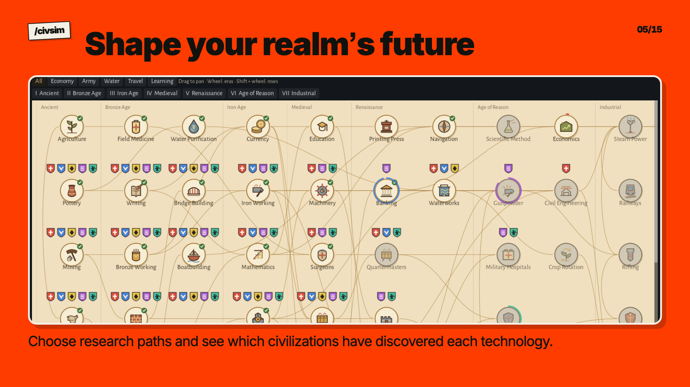
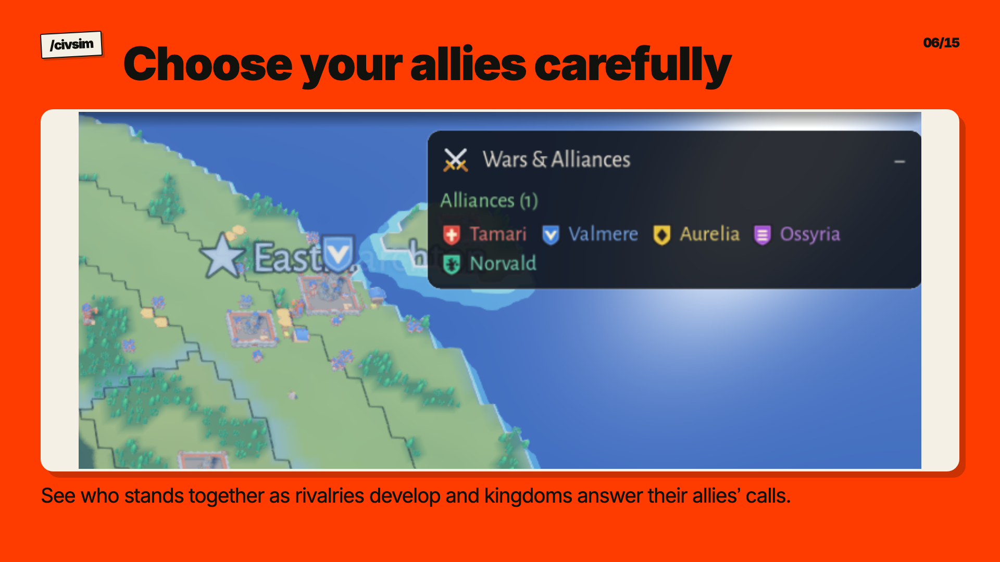
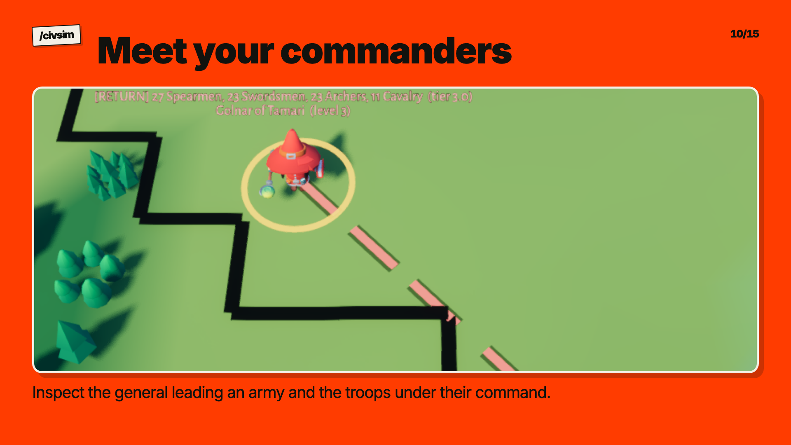
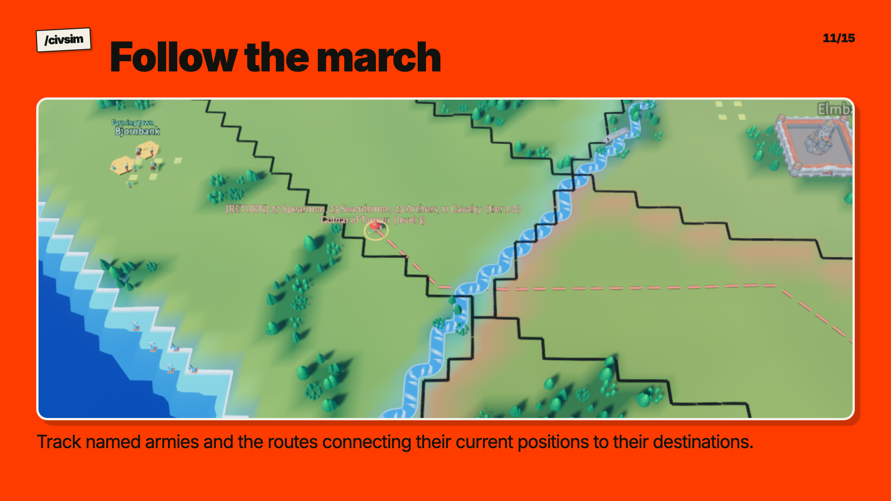
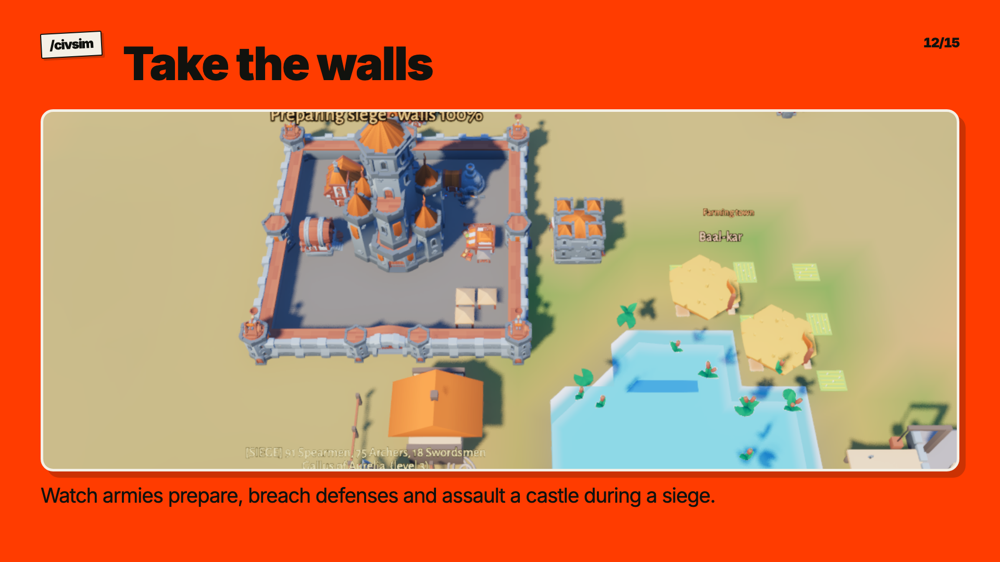
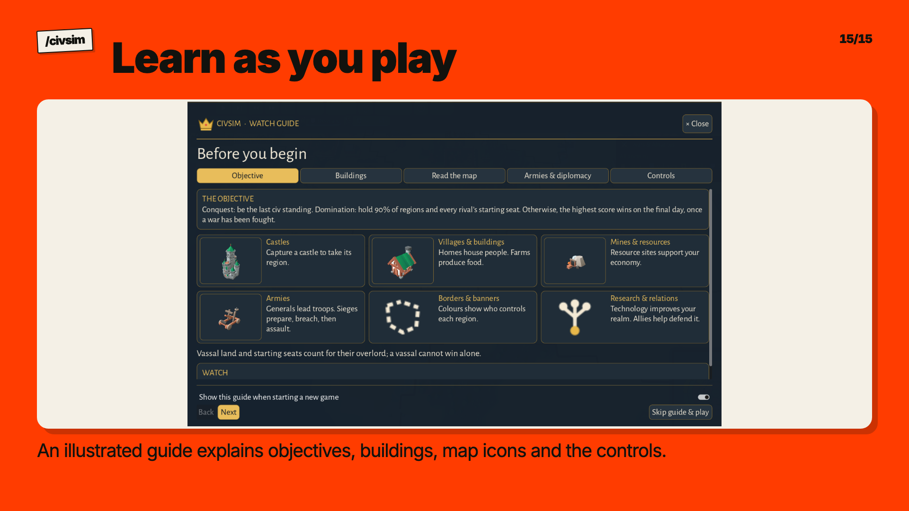

# CivSim feature gallery

Fifteen annotated views from development builds. Gameplay and presentation are still evolving.

[← Project overview](README.md) · [Gallery polish TODO](TODO.md)

## Choose your campaign

### 01. Rule a realm. Watch a world.

Take the crown yourself, or follow rival kingdoms as they build, negotiate and fight.

### 02. A world of rival kingdoms

Follow changing borders, competing rulers and the alliances that connect their realms.

### 03. Choose your battlefield

Explore nine handcrafted maps, with room for six civilizations on every large map.

## Build and negotiate

### 04. Build a thriving realm

Inspect a castle, its buildings and its people as your settlements grow.

### 05. Shape your realm’s future

Choose research paths and see which civilizations have discovered each technology.

### 06. Choose your allies carefully

See who stands together as rivalries develop and kingdoms answer their allies’ calls.

## Guide a realm and dynasty

### 07. Give your realm direction

Set priorities, queue construction and research, and follow your orders as they progress.

### 08. Understand the ruler

Read a realm’s concerns, its ruler’s outlook and its relationships with other civilizations.

### 09. Every crown has a family

Follow marriages, heirs and succession through the royal family tree.

## Command your armies

### 10. Meet your commanders

Inspect the general leading an army and the troops under their command.

### 11. Follow the march

Track named armies and the routes connecting their current positions to their destinations.

### 12. Take the walls

Watch armies prepare, breach defenses and assault a castle during a siege.

## Follow the story

### 13. History as it happens

Read the campaign’s Chronicle, from changing treaties to royal events and battlefield news.

### 14. Every war leaves a mark

Review the campaign’s participants, recorded losses and the settlement that ended the fighting.

### 15. Learn as you play

An illustrated guide explains objectives, buildings, map icons and the controls.
