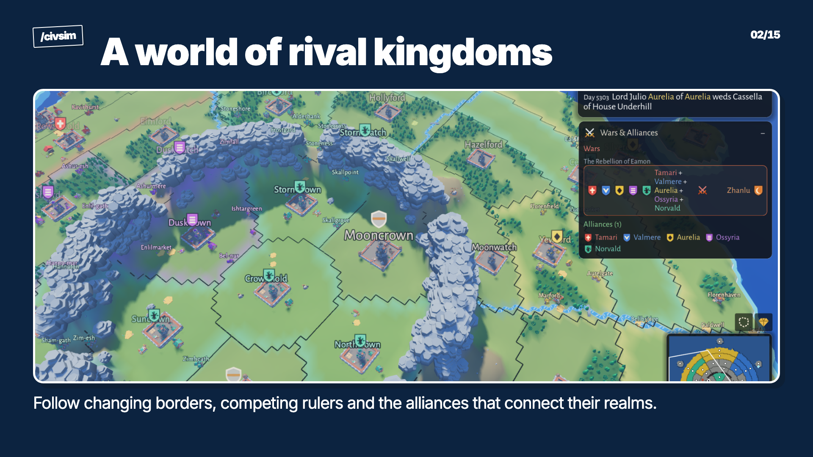

# CivSim

*Rule a realm. Or watch history unfold.*

In-development gameplay · Visuals and mechanics are subject to change

**[Explore the gallery](GALLERY.md)** · **[Development status](#development)**

---

## The world moves without you

CivSim is an independent grand-strategy project built around autonomous civilisations. Kingdoms develop, rulers make decisions, alliances shift and wars reshape the map — whether you intervene or simply observe.

### Choose your perspective

| RULE | WATCH |
| :--- | :--- |
| Guide a civilisation through economic development, research, diplomacy and military campaigns. | Follow rival kingdoms as they expand, negotiate, clash and create their own histories. |

## Inside CivSim

| **Kingdoms & economies** | **Diplomacy & conflict** |
| :--- | :--- |
| Develop settlements, manage resources and progress through a branching technology tree. | Forge alliances, coordinate armies under named commanders and lay siege to castles. |
| **Dynasties & succession** | **Handcrafted worlds** |
| Follow royal families, marriages and changes of power across generations. | Explore nine designed maps, with up to six civilisations on larger worlds. |
| **Emergent history** | **A world in motion** |
| Track events through campaign journals, announcements and war reports. | Experience a low-poly 3D world with voiced events and music. |

Save and resume campaigns, with an in-game guide for new players.

## A closer look

**[View the 15-image feature gallery →](GALLERY.md)**

Explore the world, research, player orders, royal families, commanders, sieges and the unfolding campaign through annotated development screenshots.

## Development

Inspired by an interest in how individual decisions shape complex systems, CivSim explores simulation design, emergent gameplay and the interplay of strategy and data. Its simulation core uses Python, with a Godot 4 interface and 3D world.

The project is actively evolving; gameplay, balance, visuals and features may change.

### Playable demo

**Not available publicly yet.** When a demo is ready, it will appear under [Releases](https://github.com/Pavxtoocool/CivSim-showcase/releases). No release date has been announced.

---

Public portfolio showcase only · Proprietary game source is not distributed · [Rights and usage](RIGHTS.md)
